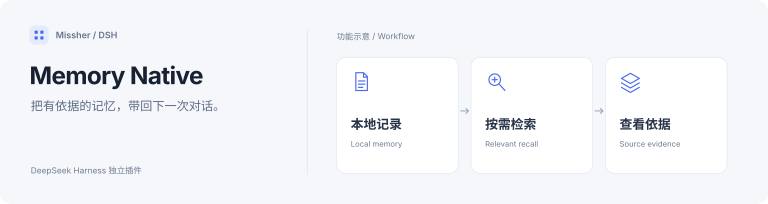

<h1>DSH Memory · 本地长期记忆</h1>

把值得记住的内容留在本地，在需要时带回对话。

  
  

<a href="#功能一览">功能一览</a> · <a href="#快速开始">快速开始</a> · <a href="#详细文档">详细文档</a>

---

<!-- current-source -->
当前开发源码：**1.3.8-native.20261107.0** · [分支 `codex/memory-evidence-navigation`](https://github.com/Missher12/Missher-DSH-Memory-Native/tree/codex/memory-evidence-navigation)。[同版预发行安装包](https://github.com/Missher12/Missher-DSH-Memory-Native/releases/tag/v1.3.8-native.20261107.0)。
<!-- /current-source -->

## 功能一览

| 能做什么 | 说明 |
| --- | --- |
| **自动记忆** | 从允许采集的对话中提取事实、偏好、决策与经验。 |
| **相关召回** | 依据当前问题查找记忆，在有限预算内注入上下文。 |
| **可视化管理** | 搜索、编辑、批准、归档、遗忘，并查看历史与来源。 |
| **知识与 Obsidian** | 把记忆提升为 Markdown 笔记，管理关联与双向同步。 |

## 快速开始

1. 从 [Releases](https://github.com/Missher12/Missher-DSH-Memory-Native/releases/tag/v1.3.8-native.20261107.0) 下载对应版本的 `.tgz` 安装包。
2. 在 DSH **插件 → 添加插件** 中选择下载的文件，安装并启用；按宿主提示重新加载或正常重启。
3. 打开 **设置 → 记忆**，检查自动捕获与注入设置，再浏览已有记忆。

## 使用前了解

- 自动提炼可能调用配置的模型并产生费用；记忆以本地 JSONL 为权威数据，派生索引可重建。
- 项目记忆与全局记忆分开召回；与旧 Memory TDAI 数据不互通，避免同时启用造成重复注入。

## 详细文档

[当前开发版说明](https://github.com/Missher12/Missher-DSH-Memory-Native/blob/codex/memory-evidence-navigation/README.md) · [设计说明](../docs/design.md) · [验证记录](../docs/verification.md) · [相关方案调研](../docs/memory-landscape.md)

原有功能细节、配置、截图与验证记录保留在上述文档中，历史结论按其注明的版本理解。
