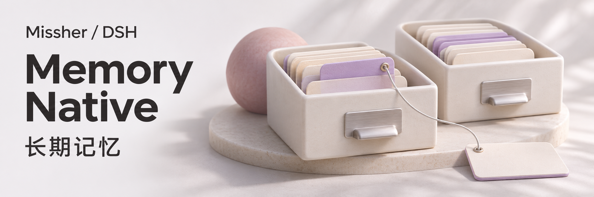
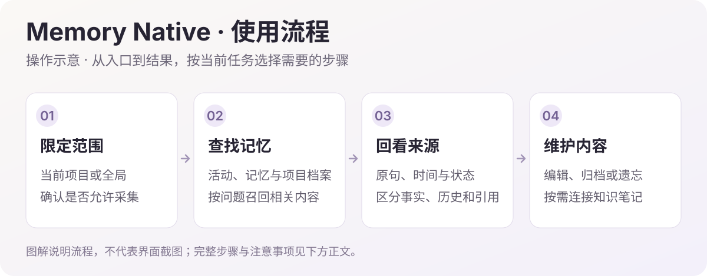
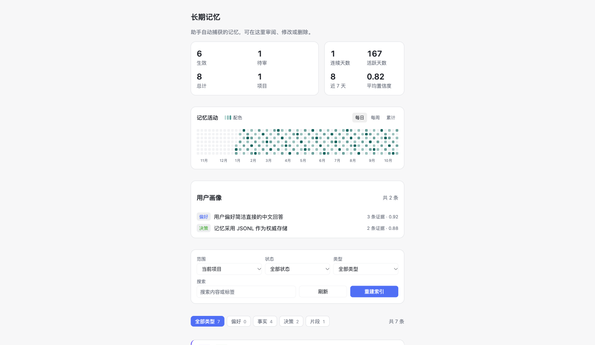
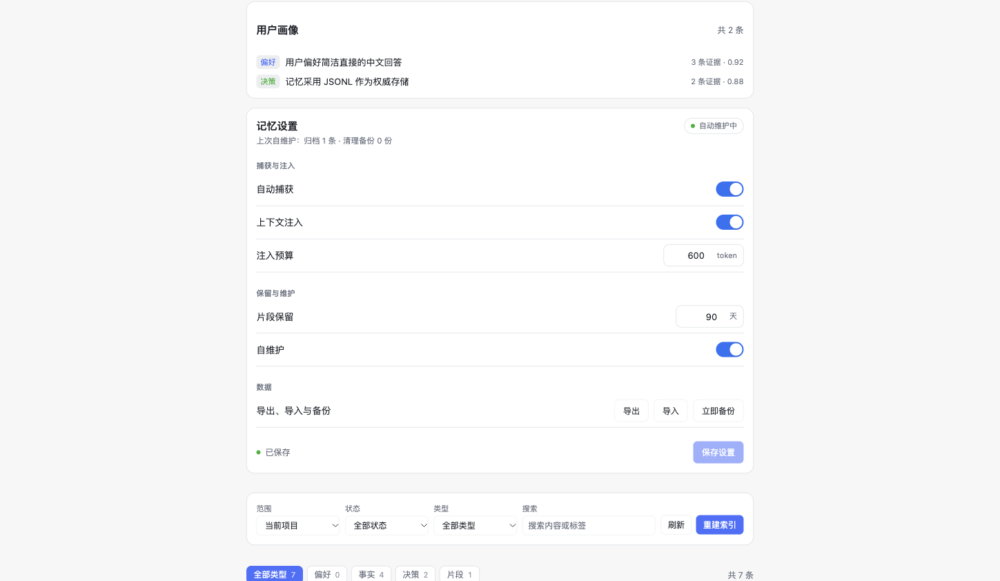

<h1>DSH Memory · 本地长期记忆</h1>

把值得记住的内容留在本地，在需要时带回对话。

  
  

<a href="#功能一览">功能一览</a> · <a href="#快速开始">快速开始</a> · <a href="#visual-guide">图解使用</a> · <a href="#使用场景">使用场景</a> · <a href="#常见问题">常见问题</a> · <a href="#详细文档">详细文档</a>

---

<!-- current-source -->
当前开发源码：**1.5.1-native.20261114.0** · [分支 `codex/memory-evidence-navigation`](https://github.com/Missher12/Missher-DSH-Memory-Native/tree/codex/memory-evidence-navigation)。[同版预发行安装包](https://github.com/Missher12/Missher-DSH-Memory-Native/releases/tag/v1.5.1-native.20261114.0)。
<!-- /current-source -->

## 功能一览

| 能做什么 | 说明 |
| --- | --- |
| **自动记忆** | 从允许采集的对话中提取事实、偏好、决策与经验。 |
| **相关召回** | 依据当前问题查找记忆，在有限预算内注入上下文。 |
| **可视化管理** | 搜索、编辑、批准、归档、遗忘，并查看历史与来源。 |
| **知识与 Obsidian** | 把记忆提升为 Markdown 笔记，管理关联与双向同步。 |

## 快速开始

1. 从 [Releases](https://github.com/Missher12/Missher-DSH-Memory-Native/releases/tag/v1.5.1-native.20261114.0) 下载对应版本的 `.tgz` 安装包。
2. 在 DSH **插件 → 添加插件** 中选择下载的文件，安装并启用；按宿主提示重新加载或正常重启。
3. 打开 **设置 → 记忆**，检查自动捕获与注入设置，再浏览已有记忆。

<!-- visual-guide -->

## 图解使用流程

先确认记忆属于哪个项目，再回看原句，区分现在、过去和待确认。

[查看完整流程图](../docs/images/workflow-guide.svg)

| 步骤 | 怎样操作 | 需要留意 |
| --- | --- | --- |
| 1. 检查采集 | 在设置中确认自动捕获、来源许可和调用预算。 | 从活动页查看处理进度，不能把待处理或未知状态算成已写入。 |
| 2. 按范围查找 | 在同一项目的新会话提出相关问题，再查看记忆或项目档案。 | 项目内容与全局偏好分开；当前事实和指定时间的历史答案分开。 |
| 3. 回到原句 | 核对来源、时间和确认状态，再决定是否作为依据。 | 引用、模型推测和待确认内容不能自动升级为用户已确认事实。 |
| 4. 维护与整理 | 有误时编辑、归档或遗忘；需要知识笔记时再启用 Obsidian。 | JSONL 是本地权威记录，派生索引可以重建，更新不需要清空记忆库。 |

### 试一次

> 以后在这个项目中优先用中文解释，代码标识保留英文。请把它作为项目偏好；之后回答相关问题时，能回看这条要求的来源。

使用后可以这样核对：

- 来源能回到对应原句，而不只有一段二次总结。
- 当前、历史、待确认和引用内容有明确区分。
- 预算、完成状态与实际召回依据可核对；未知费用结果不会自动重发。

### 设置怎么选

| 项目 | 建议 |
| --- | --- |
| 捕获与召回 | 分别确认允许采集的范围，以及回答时参考记忆的预算。 |
| 调用预算 | 自动提炼和深度查找可能使用模型；查看已有记忆不等于重新提炼。 |
| 知识与备份 | JSON 导入导出与完整备份用途不同，先按所需范围选择。 |

### 配合 Obsidian 使用

在设置中指定 vault 与同步文件夹，只同步该目录下的知识笔记。知识笔记支持双向同步；冲突保留双方版本，旧版本保留历史，已遗忘内容不会因为旧笔记再次出现。自动同步只在 DSH 运行时执行。

阅读入口位于 `<vault>/<同步文件夹>/阅读/首页.md`，按决策、知识、偏好、经验及项目、主题组织，保留原句和来源。“我的补充”会保留；阅读层可重新生成，不反向作为新记忆导入。可先看[虚构示例库](https://github.com/Missher12/Missher-DSH-Memory-Native/blob/codex/memory-evidence-navigation/docs/demo/obsidian-vault/README.md)，再决定是否连接自己的 vault。

<!-- existing-screenshots -->
### 界面示例

<table><tr><td></td><td></td></tr></table>

项目已有版本界面参考，用于说明范围筛选、管理与设置思路，不代表本次原生版的最新布局。当前四个入口为“活动 / 记忆 / 项目档案 / 设置”，以原生版实际界面为准。 详情见<a href="../README.md">项目原说明</a>，点击可放大。
<!-- /existing-screenshots -->

读图重点是范围、状态和来源，不是活动数字本身。新原生版以活动页为默认入口；历史截图中的旧卡片布局不作为当前设置步骤。
<!-- /visual-guide -->

## 使用前了解

- 自动提炼可能调用配置的模型并产生费用；记忆以本地 JSONL 为权威数据，派生索引可重建。
- 项目记忆与全局记忆分开召回；与旧 Memory TDAI 数据不互通，避免同时启用造成重复注入。

<!-- readme-expansion -->
## 使用场景

| 遇到的情况 | 怎样使用 |
| --- | --- |
| 同一个项目换了会话，还需要反复交代背景 | 保存项目事实、偏好和已确认决定，并在相关问题中按范围查找。 |
| 一个事实后来发生变化，需要知道现在和过去各是什么 | 保留来源与历史变化，区分当前事实、旧决定和指定时间的答案。 |
| 想把长期有用的内容整理成自己能管理的资料 | 通过活动、记忆、项目档案和设置入口查看进度、编辑内容与管理知识笔记。 |

## 常见问题

它和 Memory TDAI、独立 Obsidian Memory 是同一个插件吗？

不是。本仓库维护当前的 Memory Native，包名是 @missher/dsh-memory。旧插件的数据格式和运行方式不因此自动互通。

它和 MSE Learning 有什么区别？

Memory 侧重事实、偏好、决定、来源和知识；MSE 侧重长期纠正及具体失败经验。二者职责不同，开启其中一个不等于另一个的数据已经迁入。

记忆会立即自动生效吗？

后台提炼受到来源许可、预算、模型返回和处理状态影响。请在活动页区分待处理、完成、部分完成和未知状态；结果未知的付费任务不会自动重发。

知识笔记能和 Obsidian 配合吗？

可在支持的设置中指定 vault 和同步文件夹，按当前开发版说明启用同步。仅处理指定的 DSH 目录，冲突需要检查，不把整个个人 vault 当作无差别同步目标。

## 搭配使用

配合 [MSE Learning](https://github.com/Missher12/Missher-MSE-Learning) 积累工作经验，配合 [Context Manager](https://github.com/Missher12/Missher-DSH-Context-Manager) 整理当前长会话。项目与全局记忆的作用范围仍需分别管理。

## 升级与数据

当前原生预发行版为 1.5.1-native.20261114.0，维护源码位于 codex/memory-evidence-navigation；main 保留稳定版本源码及首页说明。JSONL 是权威记录，派生索引可重建；升级不能通过删除记忆库来替代迁移。
<!-- /readme-expansion -->

## 详细文档

[当前开发版说明](https://github.com/Missher12/Missher-DSH-Memory-Native/blob/codex/memory-evidence-navigation/README.md) · [设计说明](../docs/design.md) · [验证记录](../docs/verification.md) · [相关方案调研](../docs/memory-landscape.md)

原有功能细节、配置、截图与验证记录保留在上述文档中，历史结论按其注明的版本理解。
