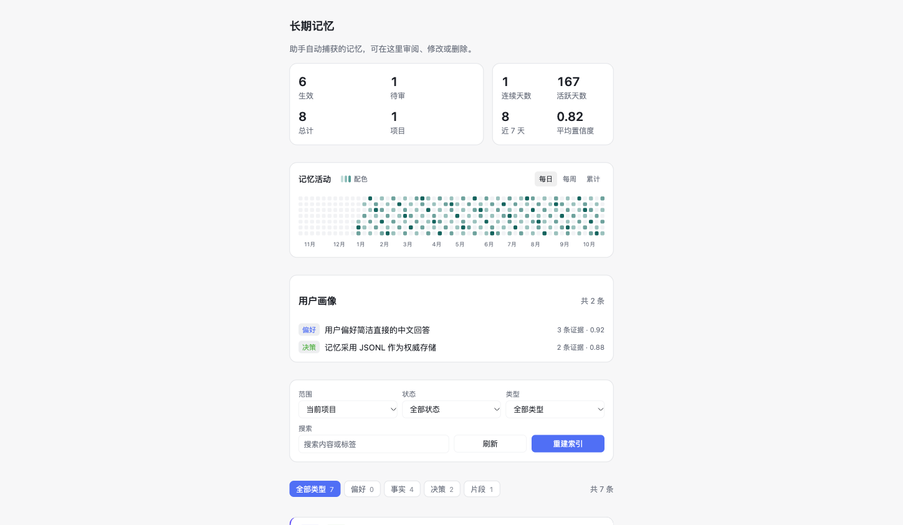
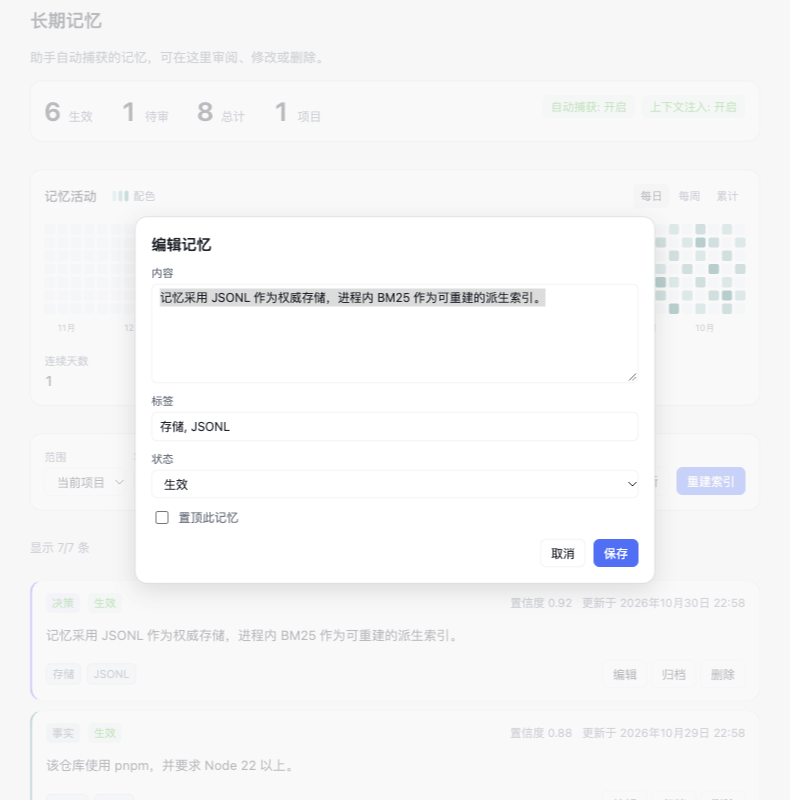
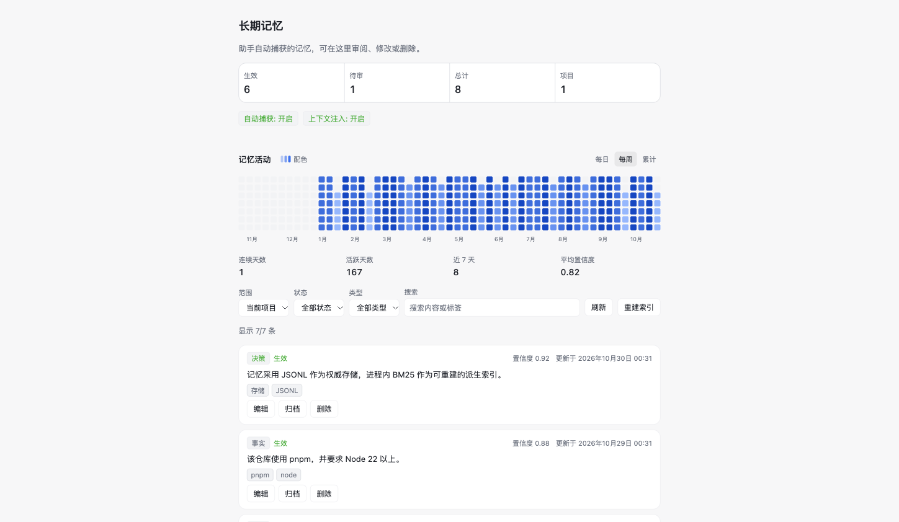
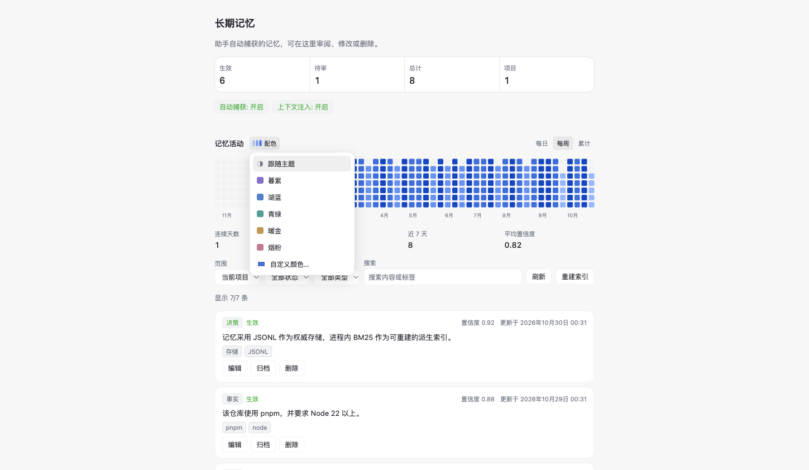
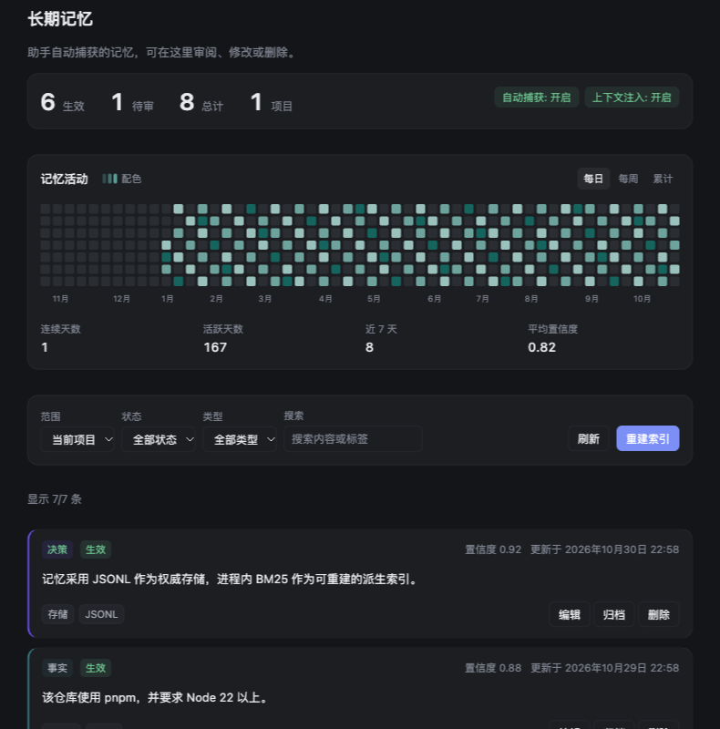
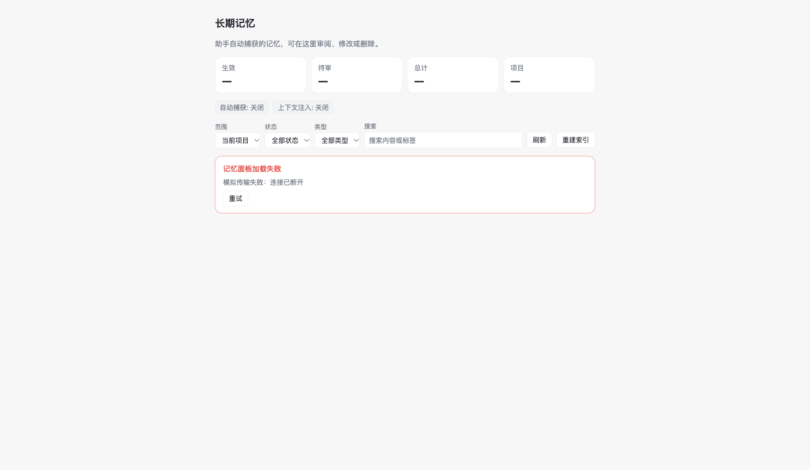
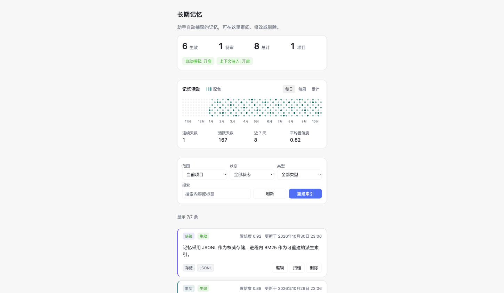

# DSH Memory

最新原生开发版 **1.3.8-native.20261107.0** · [源码分支](https://github.com/Missher12/Missher-DSH-Memory-Native/tree/codex/memory-evidence-navigation) · [预发行安装包](https://github.com/Missher12/Missher-DSH-Memory-Native/releases/tag/v1.3.8-native.20261107.0)

本 `main` 分支保留 1.0.0 源码与下方历史说明；下载最新源码请使用上方开发分支。
本地优先的 DeepSeek Harness 长期记忆插件。自动捕获、按需注入、可视化管理——不依赖外部数据库或云服务。

[仓库](https://github.com/Missher12/Missher-DSH-Memory-Native) · [Releases 下载](https://github.com/Missher12/Missher-DSH-Memory-Native/releases) · [设计文档](docs/design.md) · [验证记录](docs/verification.md)

## 能做什么

- **自动记忆**：每个完成的 turn 结束后，后台用当前模型抽取事实 / 偏好 / 决策 / 经验，写入本地；长对话自动分块抽取，近重复语句合并为一条并提升置信度；值/否定冲突（如 Node 22 → 24）走 SUPERSEDE。
- **完整采集与证据**：每条允许采集的消息（含来源类别 `source.kind`）完整写入本地 `capture/sources`（0600、gzip 透明读回），分段任务覆盖全文；`capture/capture-tasks.jsonl` 记录 pending / running / done / partial / unknown / failed 与处理进度。有可用正文的截断按范围拆分；没有正文时暂停该模型连续调用，显式恢复只新增一个带更大输出额度的缺失段任务，旧付费回执保留。不能再拆的小段最多补全两轮，只处理遗漏。完整标记与 provider 终止状态共同决定完成，持续无进展保留 partial，模型结果未知不会自动重试。明确不保存记忆或仅供验收的虚构资料在请求模型前跳过；内部记忆注入不作为新事实证据；助手推测、引用或用户转述默认只进入候选。
- **共享与遗忘**：项目记忆按 projectKey 在同项目不同会话间共享，global 才跨项目；删除写入 tombstone，待处理任务不会再把它写回，派生画像与图谱同步排除已删除记录。
- **数据安全**：写入带跨进程锁与 fsync，压缩前锁内重读；坏行隔离到 `corrupt-lines.jsonl`；schema 版本可迁移、拒绝更新版本；支持导出/导入/备份。
- **越用越懂反馈**：面板批准候选 → 置信度 +0.1、重要度 +0.05；编辑内容 → 重要度 +0.05；固定 → 重要度拉到 0.9，直接影响后续召回排序。
- **自维护（自己掌控）**：启动后自动执行维护——按保留期归档低置信度旧片段（默认 90 天、不碰固定/高置信）、每天自动备份、只保留最近 7 份备份，结果写入 `maintenance.json`；可用 `maintenance.enabled` 关闭。
- **设置可写**：面板「记忆设置」卡可改自动捕获、上下文注入、注入预算、片段保留天数、自维护开关；写入 `settings.json`，即时生效、重启保留。
- **抗崩溃与容量**：存储初始化/召回/捕获/定时器/panel 异常隔离；存储不可用时禁用插件。数值倒排索引支持完整计数与分页，更新和遗忘后回收旧槽位；50k 隔离数据的性能和启动限制见下方验证证据。
- **八个一级标签**：记忆 / 用户画像 / 知识图谱 / 知识库 / 捕获与注入 / 保留与维护 / 数据 / Obsidian；知识库管理提升出的长期笔记并同步 Obsidian。
- **完整知识图谱**：每个小主题独立显示，搜索和分页覆盖所选范围的全部节点；可查看并跳转出链、反链和未解析目标，支持 Wiki 双链、标题锚点与 Markdown 内链。记忆可一键「提升为知识」写成长期 Markdown 笔记。
- **知识库编辑（v0.10）**：知识库 tab 点任意笔记打开编辑器，可改标题 / 主题 / 标签 / 正文；保存原子写回 `knowledge/<id>.md`，保留 frontmatter 与 memoryId；文件被外部修改时提示重新加载，不静默覆盖。
- **知识双向同步**：知识笔记与 `<vault>/<folder>/knowledge` 自动往返，新增笔记及单边编辑自动同步；两边同时编辑或一边删除时保留双方，展开完整内容后选择版本。知识笔记之间的双链与反链可在图谱中查看。
- **Obsidian 自动同步**：在「Obsidian」标签填写 vault 路径与文件夹，开启自动双向同步并保存。DSH 运行期间，上一轮结束约 5 秒后检查变化，无需反复导入导出；关闭 DSH 期间的修改会在下次运行后核对。兼容标准 YAML 属性，未改变的笔记不增加版本；冲突副本保存在 `_conflicts`，替换文件保存在 `_history`，已遗忘记忆不会从旧笔记复活。同步仅处理指定目录内的 DSH 记忆与知识笔记。
- **好管理（v0.7）**：回收站（恢复 / 彻底删除）、批量归档/删除/加标签（失败自动回滚）、版本历史与 diff、主题筛选与合并建议。
- **数据可搬运**：面板支持「导出 / 导入 / 立即备份」——导出为 JSON 下载，导入按 revision 去重合并并重建索引，备份写入 `backups/`。
- **省 token**：注入预算按命中数自适应（1/3/6 条 → 200/256/352，短续问 220），记忆行去掉 id/日期/置信度等元信息；抽取规则与 GUIDANCE 精简，每次最多 4 条、每条 ≤120 字、默认输出上限 4096 token（部分宿主路由把推理也计入上限，选择 off 不一定实际关闭推理），补全任务获得额外余量，截断时保留已写完的条目；额度是上限，实际用量依据服务端回执；面板「捕获与注入」显示近 7 天注入/抽取 token 趋势与超预算次数。典型单轮 token 估算从 4113 降到 2392（−42%）。
- **召回门控**：内容词 + 绝对 BM25 分段（S_bi、区分度、加权覆盖率，按 I1 随语料规模缩放）；「你好/好的/今天天气」以及「数据库迁移/翻译/灰度发布」等弱查询不再注入；灰区写入 `recall-gate.jsonl` 待模型判定；「继续/然后呢」等短续问自动使用上一条用户消息检索。
- **画像防误合并**：同 topic 也要求 bigram 相似度 ≥0.5；否定（不/不必）、反义（深/浅、可写/只读）与数字/版本冲突不合并。
- **越用越懂（v0.3）**：抽取时附带主题标签；偏好聚合成带证据的用户画像（面板可见、注入时优先）；episodic 90 天 / profile 60 天半衰期衰减；偏好与决策使用 0.85 灰区合并。
- **按需注入**：每步推理前用当前用户消息检索（BM25 + 时间 + 重要度 + 置信度），把一小段 `<memory-context>` 注入上下文，默认 600 token 上限。
- **本地可读**：权威数据保存在 `~/.dsh/dsh-memory/**/memories.jsonl` 明文。可重建的 `derived-index-v1.bin` 缓存加快索引、画像和图谱的恢复，缓存失效时完整读取权威文件。
- **可管理**：Settings → 记忆 面板支持查看、搜索、编辑、审批、归档、删除（M4）。
- **可控成本**：每日抽取调用上限、单次输出上限、注入预算都可配，也可一键关闭捕获或注入。

## 记忆模型

四类 × 双作用域：

| kind | 含义 | 默认作用域 |
|---|---|---|
| `preference` | 用户偏好、习惯、沟通方式 | global |
| `fact` | 项目/技术事实、约束 | project |
| `decision` | 已做出的选择及理由 | project |
| `episode` | 一次任务经历中的可复用教训 | project |

记录带 `confidence`、`importance`、`observedAt` / `validFrom` / `validTo`、`revision`、`supersedesId`，支持冲突替换和墓碑删除。

## 存储布局

```
~/.dsh/dsh-memory/
├── meta.json
├── usage.jsonl            # 注入/抽取 token 遥测（有界，可删）
├── global/memories.jsonl
└── projects/<projectKey>/memories.jsonl
```

- 每行一条完整的 revision 快照；加载时按 id 取 revision 最大者。
- `projectKey` = 工作目录 basename + 绝对路径哈希，避免同名项目冲突。
- 单文件超过 2000 行或 4MB 时压缩（保留最新 revision，临时文件 + 原子 rename）。

## 配置

`cordis.patch.yml` 里按需覆盖：

```yaml
- insert:
    - id: dsh-memory
      name: '@missher/dsh-memory'
      config:
        capture:
          enabled: true
          minTurnChars: 200
          maxCallsPerDay: 50
          autoApproveConfidence: 0.75
        extraction:
          provider: null        # null = 跟随当前会话模型
          model: null
          maxOutputTokens: 4096
        inject:
          enabled: true
          maxTokens: 600
          maxItems: 12
          minScore: 0.15
        retention:
          episodeDays: 90
```

## 安装

当前本地安装版为 `0.2.25-native.20261107-local.2`。插件管理器安装、宿主重启、跨会话召回、项目隔离、遗忘以及 5 万条缓存重开的结果见 [验收记录 §73](docs/verification.md#73-大库启动原句补查与真实宿主验收2026-11-07)。实际打包使用 `python3 scripts/pack-plugin.py`。Obsidian 自动同步的验收见 §69，历史提炼任务恢复见 §70。

## 开发

```bash
# 单元测试（需要 Node ≥ 22.19）
node --test tests/*.test.js
```

安装到当前 profile 时可使用 linked 目录方式，通过 Harness 的 plugin_manager install_bundle 指定本目录绝对路径。

设计文档：[docs/design.md](docs/design.md)；行业调研：[docs/memory-landscape.md](docs/memory-landscape.md)；DSH API 侦察：[research/dsh-api-brief.md](research/dsh-api-brief.md)。

## 状态

- M1 存储 + 索引：已实现，完整 50k JSONL 加载、检索、原子替换重开通过；启动性能仍有改进空间。
- M2 自动捕获：本轮真实宿主接收 30,684 字符用户消息，全文读回一致，首中尾及全局偏好 10/10 项全部提炼；自动子段补全完成。尾段丢意图、重启误计自动配额、内部记忆回写均有复现和修复记录。
- M3 召回注入：同项目另一会话实际注入并答中；跨项目只共享 global；遗忘后另一会话不再注入被删事实并回答“不记得”。
- M4 管理面板：完成——列表/统计/筛选/编辑/审批/归档/双确认删除/重建索引；Typert RPC 已通过真实网关自检（stats + list），浏览器端真实调用已确认（修复 `remove`/`removeMemory` 命名冲突后出现独立 stats 记录）；组件在夹具中验证了浅色/深色/窄宽/编辑弹窗/空态/错误态。
- M5 安装验收记录见 verification §67。fast2 运行文件与候选包一致，正常重启后 Typert 原生自检通过，插件 fiber 为 active，元信息校验正常。

## 面板预览

以下为 Settings → 记忆 组件的测试夹具渲染（非应用内截图，数据为模拟；真实页面使用宿主主题 token）：

| 列表 | 编辑弹窗 |
|---|---|
|  |  |

面板采用卡片分区：指标卡（大数字 + 捕获/注入状态）、记忆活动卡（每日/每周/累计、可换配色、悬浮提示、等宽洞察条）、**用户画像卡（偏好聚类 + 证据条数 + 置信度）**、筛选卡、类型页签（全部/偏好/事实/决策/片段 + 条数）、带分页（10/20/50 条每页）与类型色条的记忆卡片。


| 每周 | 配色菜单 |
|---|---|
|  |  |

| 深色 | 错误态 |
|---|---|
|  |  |

窄宽（430px，统计 4 列自适应）：

## 验证证据

完整记录见 [docs/verification.md](docs/verification.md)。

| 项目 | 结果 | 证据 |
|---|---|---|
| 单元测试 | 0.2.13 全套 239/239；后续按改动复测，最终内部证据回归与真实坏返回重放 5/5 | verification §60、§64（未将旧整套结果当作最终整套验收） |
| 原生安装 | 0.2.25-native.20261107-local.2，34 个文件与包一致，重启后 Typert 自检通过，插件 active | verification §73 |
| Obsidian | 真实 1.15.0 自动往返、冲突双方保留及界面选择、知识双链跳转通过；569 条实际记忆的 vault 正文及属性逐项一致 | verification §68–69 |
| Codex 复核回归 | 9/9 通过（新增 live 生效视图、非用户来源确认） | `tests/capture-recovery.test.js` |
| 自动捕获 | 30,684 字符全文一致，10/10 测试信息提炼；4 次真实提炼、1 段内部上下文未调用模型 | verification §64，0.2.15 原生验证 |
| 跨会话与遗忘 | 实际 pre-step 注入/回答命中，跨项目隔离，项目及全局遗忘后不再注入；无工具读取答案 | verification §64，最终全局遗忘与后续提炼在 0.2.18 验证 |
| 历史任务恢复 | 原 3 pending 与 39 partial 全部 done；另外 15 个禁止保存或虚构验收任务零调用 skipped；最终 pending/partial/unknown/failed/running 均为 0 | verification §70，旧已发送任务的次数与原回执保持 |
| 面板 RPC | Typert 传输 + 网关自检 stats/list 通过 | `panel-transport.json`、`panel-calls.jsonl` |
| 面板渲染/交互 | 浅色/深色/540px/编辑保存/Esc 关闭/批准/双确认删除/空态/错误态 | `docs/images/panel-*.png`（夹具渲染） |
| Token 遥测 | 近 7 天注入/抽取趋势、平均注入、超预算计数 | `~/.dsh/dsh-memory/usage.jsonl`；`docs/demo/v09-token-trend.png` |
| 知识笔记编辑 | 打开/编辑/保存/冲突检测/重新加载，735 与 430 无溢出 | `docs/demo/v10-knowledge-editor.png`、`docs/demo/v10-knowledge-list.png` |
| 知识双向同步 | 导出 1 条/跳过 1 条、导入新笔记、冲突不覆盖；vault 节点 + wiki 边 | `docs/demo/v10-knowledge-sync.png`、`docs/demo/v10-graph-vault.png` |
| 检索评测（固定回归） | hit@5 1.000 / precisionAtMost5 0.989 / 必要证据覆盖 0.640 / 错误召回 1 题 | `node scripts/eval-recall.mjs` |
| 检索评测（独立难例） | 11 题 / 必要证据覆盖 0.917 / 错误召回 3 题 / 无答案误注入 0/2 | `node scripts/eval-recall.mjs` |
| 召回性能（50k） | 已安装 fast2、隔离全量数据、新进程。缓存重开到可检索为 244.97 / 249.52ms，首次构建含缓存写入为 2193.68ms。全文读回后搜索 p95 为 19.36 / 14.72ms。开发期间有超出 300ms 的负载样本 | verification §65–§67，Intel i9-9880H，OS 文件缓存保留 |
| 来源容量 | 用户原文全量保留，gzip 透明压缩 + 按需读回；短写循环/失败回滚；账本压缩保留身份 | `tests/capture-capacity.test.js` |

原生模型验证、隔离故障测试与合成容量测试分别记录。0.2.18 的历史恢复见 verification §64，fast2 的容量与原生召回见 §67。当时的 Qwen3.8-Flash partial 后续累计到 39 条，已在 recovery2 中补全并保留旧回执。最终真实长消息测试覆盖首、中、尾三个事实，另一会话实际注入并回答命中，遗忘后的第三会话无该注入且回答“不记得”，没有工具读取答案。新恢复调用会产生实际用量，旧版没有保存的 usage 无法补算；不会将未知请求自动重发。每日自动提取额度仍保留，达到额度的新任务会等待下一个预算周期或显式恢复，详见 §70。

## 诊断文件

- `~/.dsh/dsh-memory/panel-transport.json`：面板传输方式（typert / web-server）与网关自检结果。
- `~/.dsh/dsh-memory/panel-calls.jsonl`：面板 RPC 调用日志。客户端激活时会做一次只读 `stats` 预热调用，
  所以**刷新页面**就会出现一条浏览器来源的 `stats`；打开「设置 → 记忆」还会追加 `list`。

## 限制（v1）

- 无向量/图检索；中文靠 CJK bigram，纯 JS 实现。
- 来源原文保留并压缩，仍受本地磁盘容量约束；遗忘阻止后续召回和后台复活，不等于擦除历史原文、审计记录或用户另存的笔记。
- 提炼拆分有深度和最小片段边界；持续无效输出仍需显式处理，不能保证模型抽取或回答永远正确。当前宿主 MSE 在 Memory 之前限制单次 prompt 为 32,768 字符，本轮未修改 MSE。
- 不跨设备同步，不做多用户/多 Agent 权限治理。
- 与 @missher/dsh-memory-tdai 数据不互通；两者同时启用会造成重复注入，建议只启用一个。
